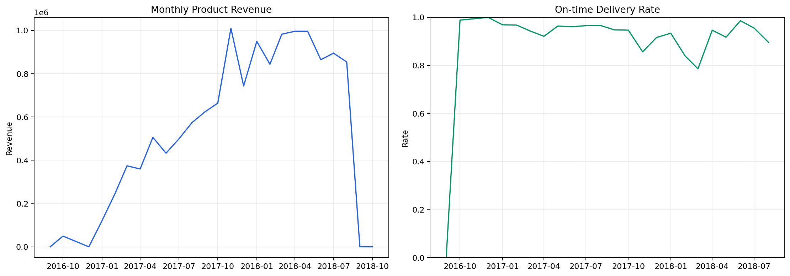
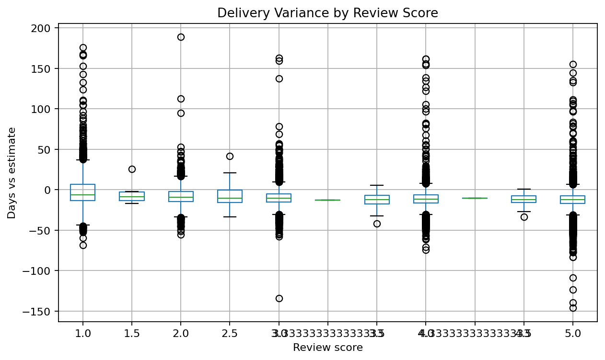
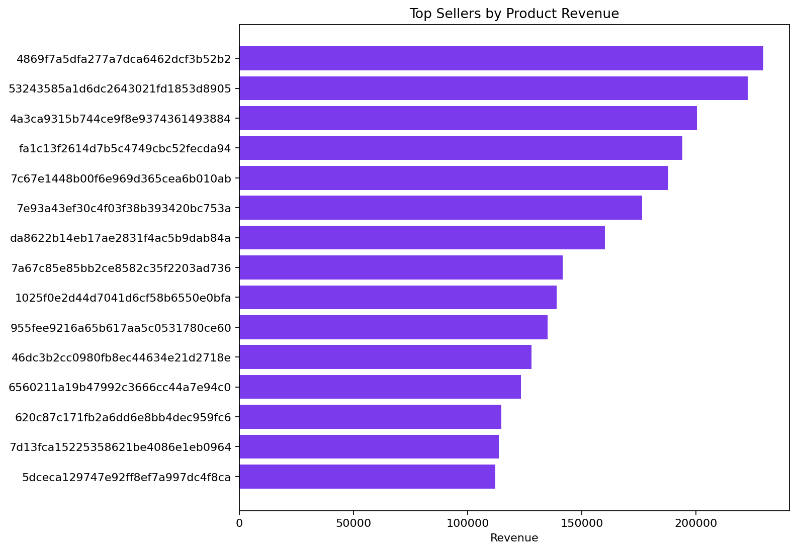

# E-commerce Delivery and Customer Experience

**Author:** Mohammed Adeen Shaik  
**Review date:** 11 October 2026

## Research question

How do delivery reliability, seller concentration and reviews vary within the Olist marketplace?

## Data and provenance

Publisher-provided Olist historical marketplace tables.

Source materials are linked from the repository README. Input fingerprints are recorded in [the evidence manifest](evidence.json) so a reader can identify the exact committed artifacts used in this review.

## Method and analytical rationale

Orders are the reporting grain. Items, payments and reviews are aggregated before joining so a many-to-many merge cannot inflate order-level totals.

## Findings and interpretation

Fresh execution on 11 October 2026 using publisher Olist tables. The reporting model contains **99,441 order-level records**. Monthly revenue and on-time delivery rates use the exported monthly scorecard. Review-versus-delivery plots are associations within delivered and reviewed records, not evidence of a causal improvement. Customer and seller identifiers are not published in the reading edition.

| Measure | Value |
|---|---:|
| order rows | 99441 |
| monthly buckets | 25 |

## Limitations

Review associations do not establish that delivery timing caused a rating. Revenue is product value, not marketplace profit. Seller comparisons require adequate volumes.

## Reproduction

Use the setup commands and input contract in the [repository README](https://github.com/Adeen1607/ecommerce-operations-analytics#readme). Open the [notebook catalogue](notebooks.html) for annotated code and saved outputs. Keep raw records and model binaries local; public reports contain aggregate results or source-embedded figures.

## Final visual results

*Figure from key_visuals.ipynb, original code cell 3.*

*Figure from key_visuals.ipynb, original code cell 4.*

*Figure from key_visuals.ipynb, original code cell 5.*

